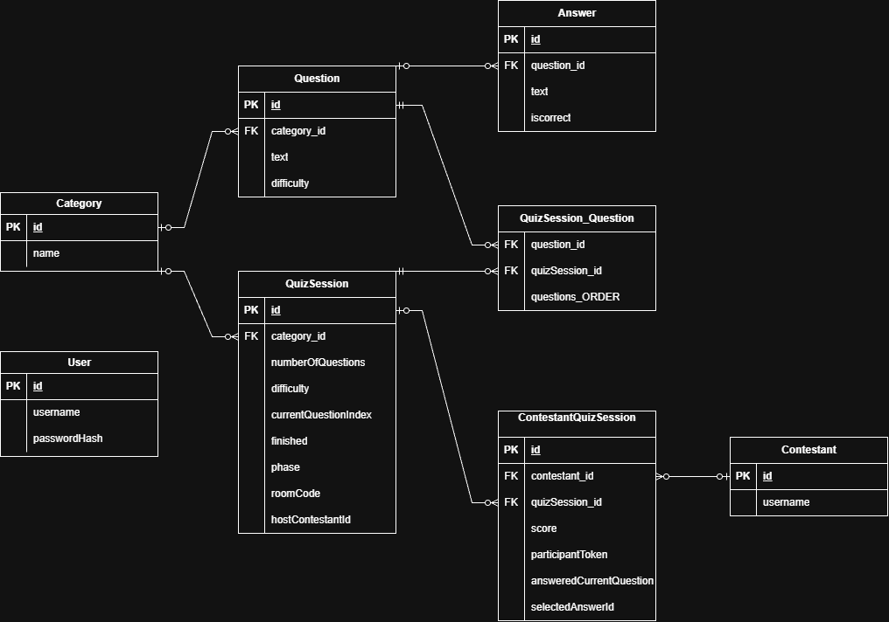

# Quiz

## Vision

This project is a Java backend for a quiz game. Players can answer questions in singleplayer mode or join a multiplayer room and play together.

## Links

- **Source code:** https://github.com/ErosiaBjerrum/Quiz
- **Deployed application:** N/A
- **Portfolio website:** N/A

# Architecture

## System Overview

The backend uses a layered structure:

- **Routes** define the REST endpoints.
- **Controllers** receive requests and return responses.
- **Services** handle the quiz rules, question imports and multiplayer logic.
- **DAOs** read and write data using JPA/Hibernate.
- **Entities** represent the data stored in PostgreSQL.
- **DTOs** control which data is sent to and from the API.

The project uses Java, Maven, Javalin, JPA/Hibernate, PostgreSQL, Jackson, JWT and WebSockets. Tests use JUnit 5, Rest Assured and Testcontainers.

There is also a small HTML, CSS and JavaScript frontend used for visual testing.

## Architecture Diagram

```text
Browser / API client
       |
       +-- REST --> Routes --> Controllers --> Services --> DAOs --> PostgreSQL
       |                                          |
       |                                          +--> QuestionProvider --> OpenTDB
       |
       +-- WebSocket --> QuizWebSocketController --> QuizService
```

## Key Design Decisions

**Separate layers**

I use separate controllers, services and DAOs. This keeps HTTP handling, quiz logic and database access separate.

**Question imports**

Questions currently come from OpenTDB. I use a `QuestionProvider` interface so another question source can be added later without changing the import service. The import also checks for existing questions to avoid importing the same text twice.

**Multiplayer**

Multiplayer uses WebSockets to send questions, results and room updates to connected players. Players join using a four-digit room code, and each participant gets a token. The host controls when the quiz starts and moves to the next question. Each question has a 30-second timer.

**Authentication**

Users can register and log in. Passwords are hashed with BCrypt. Login returns a JWT that is valid for two hours. The question import endpoint requires a valid JWT, but the quiz endpoints are currently public.

**Error handling**

The API uses HTTP status codes such as 400 for invalid input, 401 for missing or invalid authentication and 404 when a resource is not found.

# Data Model

## ERD

The main relationships are shown below.




## Important Entities

- **Question:** The question text, difficulty, category and possible answers.
- **Answer:** An answer option and a flag showing whether it is correct.
- **Category:** Groups questions by topic.
- **QuizSession:** Stores the selected questions, current question index, quiz phase and optional multiplayer room code.
- **Contestant:** A player name.
- **ContestantQuizSession:** Connects players to a quiz session and stores their score, answer status and participant token.
- **User:** A registered account with a username and BCrypt password hash.


# API Documentation

The backend runs on port `7070` by default.


| Method | Endpoint | Purpose |
|---|---|---|
| GET | `/questions` | Get stored questions |
| POST | `/questions/import` | Import questions from OpenTDB (JWT required) |
| POST | `/quizzes` | Start a singleplayer quiz |
| GET | `/quizzes/{sessionId}/question` | Get the current question |
| POST | `/quizzes/{sessionId}/answer` | Submit an answer |
| GET | `/quizzes/{sessionId}/status` | Get score and quiz status |
| POST | `/quizzes/rooms` | Create a multiplayer room |
| POST | `/quizzes/rooms/join` | Join a multiplayer room |
| GET | `/quizzes/rooms/{sessionId}/participants` | Get the room's players |
| POST | `/auth/register` | Register a user |
| POST | `/auth/login` | Log in and receive a JWT |
| GET | `/auth/me` | Check a JWT and get the user ID |

**WebSocket:** `/ws/quiz/{sessionId}` is used to send quiz questions, scores and game updates to players in multiplayer mode.

### Example: Start a quiz

`POST /quizzes`

```json
{
  "username": "Player1",
  "numberOfQuestions": 5,
  "difficulty": "EASY"
}
```

Response: `201 Created`

```json
{
  "sessionId": 1
}
```

### Example: Submit an answer

`POST /quizzes/1/answer`

```json
{
  "answerId": 10
}
```

The response includes whether the answer was correct, the correct answer text, points earned and total score.

# User Stories

- As a player, I want to choose a quiz difficulty and number of questions.
- As a player, I want to answer questions and see my score.
- As a player, I want to create a multiplayer room and invite other players using a room code.
- As a player, I want to see the questions and results at the same time as the other players.
- As a registered user, I want to log in and receive a token.
- As an authenticated user, I want to import more questions.

# Running the Project

- Install Java and Maven, and start a local PostgreSQL database named `quiz`.
- The local database settings in `HibernateConfig` use username `postgres` and password `postgres`. Change these for your own setup.
- Set the `JWT_SECRET` environment variable before starting the application.
- Run the `Main` class. Javalin starts on port `7070`.
- When starting with an empty database, questions must be imported before a quiz can be played. First, register a user through `/auth/register` and log in through `/auth/login`. Then use the returned JWT to import questions from OpenTDB through `/questions/import`.

Run the tests with `mvn test`. The integration tests use Testcontainers, so Docker must be running.
